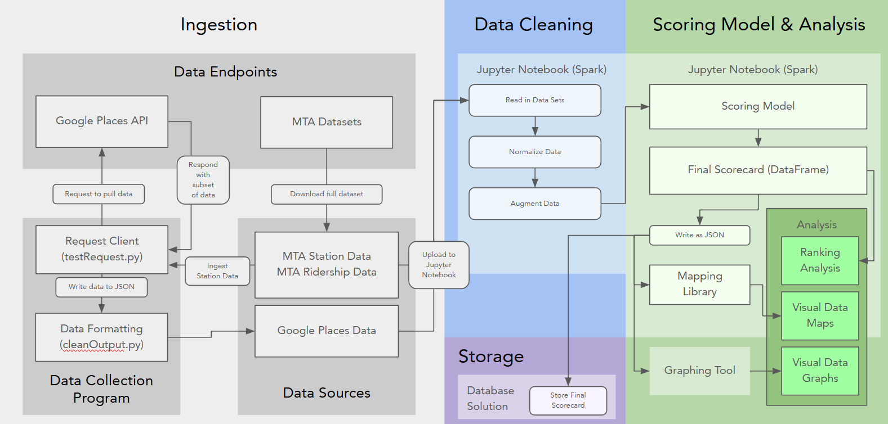

# Arts Accessibility Scorecard for New York City

**A Big Data course capstone by Hoi Cheng and Rebecca (Becca) Weng · NYU Tandon · Summer 2025**

How does access to cultural spaces vary across New York City's subway network? As native New Yorkers, we wanted to explore how transit and geography shape opportunities to experience the arts.

This project combines MTA station and ridership data with Google Places location data to build a prototype cultural-accessibility scorecard. We use Python and Apache Spark to collect, clean, and integrate the data, then compare stations and subway lines through rankings and geographic visualizations.

The score describes the cultural destinations near a station, with an adjustment for ridership. It is an exploratory measure of nearby cultural availability, not a validated measure of a person's ability to reach or participate in those activities.

## Project at a glance

* See [Final Project Report (PDF)](https://drive.google.com/file/d/1ZFTdb-JRVFBE81g0pEjKFEPNKFeS49jt/view?usp=sharing)
* [Final Project Presentation (Google Slides)](https://docs.google.com/presentation/d/1_NBa0GOV1V1w40mjsm-qBcJYCDq2mDND1WWRon2kIk8/edit?slide=id.g36e363f97c2_0_27#slide=id.g36e363f97c2_0_27)

| Component | Scope |
| --- | --- |
| Station data | 496 source records, expanded into 767 station–route records |
| Ridership sample | 20 randomly selected dates between January 1 and July 10, 2025 |
| Ridership records | 8,364 daily station-complex aggregates returned by the API |
| Cultural destinations | Nine Google Places categories within approximately one mile of each station coordinate |
| Prepared dataset | 13,467 joined rows covering 409 station-complex labels before the ridership filter |
| Published results | 408 station-complex entries and 23 subway route labels |
| Outputs | A score on a 0–100 scale, station and line rankings, distribution plots, and maps |

The presentation describes a ridership source containing approximately 17.9 million rows at the time of the project. Our analysis uses a sampled, aggregated extract from that source; it does not load all 17.9 million records into Spark.

## Data sources

- **[MTA Subway Stations](https://data.ny.gov/Transportation/MTA-Subway-Stations/39hk-dx4f/about_data):** station identifiers, coordinates, boroughs, and subway routes.
- **[MTA Subway Hourly Ridership Beginning 2025](https://data.ny.gov/Transportation/MTA-Subway-Hourly-Ridership-Beginning-2025/5wq4-mkjj/about_data):** queried through the Socrata API using SoQL to aggregate subway ridership by date and station complex.
- **[Google Places API](https://developers.google.com/maps/documentation/places/web-service/nearby-search):** nearby cultural destinations, requested separately for each category and station coordinate.
- **[NYC borough boundaries](https://github.com/nycehs/NYC_geography/blob/master/borough.geo.json)** and an MTA station GeoJSON export: geographic context for the maps.

The nine cultural categories are art galleries, art studios, auditoriums, cultural landmarks, historical places, monuments, museums, performing arts theaters, and sculptures.

## Workflow



### 1. Collect and prepare transit data

The ingestion notebook reads the station CSV and expands each station's route list into individual rows. It then selects 20 dates without replacement from the available January–July window, using a fixed random seed (`20250719`). SoQL queries aggregate hourly ridership into daily totals for each station complex before returning the results as JSON.

### 2. Collect nearby cultural destinations

The Google Places collection script searches within a 1,609-meter radius of each station coordinate, ranks results by distance, and requests each cultural category separately. Responses are converted from protocol-buffer objects to dictionaries and saved as JSON. A formatting script restructures the station-keyed data into a JSON array for ingestion.

The prototype retrieves up to 20 places per station/category search. These counts represent returned results rather than a complete inventory of cultural destinations.

### 3. Clean and join the datasets

PySpark transformations parse station names and routes, join ridership to station metadata, and match the resulting records to Google Places data using coordinate strings. Nested location responses become numeric columns containing counts for each cultural category. Values of `-1`, produced by the size operation on missing arrays in the project environment, are replaced with zero.

The prepared CSV retains station, route, date, ridership, geographic information, and the nine cultural-category counts.

### 4. Build the scorecard

The prototype combines three components:

| Component | Maximum contribution | Calculation |
| --- | ---: | --- |
| Quantity | 65 points | Weighted count of nearby cultural destinations, min–max scaled across the retained data |
| Variety | 25 points | Sum of category weights for categories with at least one returned destination, multiplied by 25 |
| Crowdedness | 10 points | Inverse min–max scaling of log-transformed daily ridership |

```text
Availability score = Quantity score + Variety score + Crowdedness score
```

The quantity and variety components use the following category weights:

| Category | Weight |
| --- | ---: |
| Museum | 0.300 |
| Art gallery | 0.200 |
| Cultural landmark | 0.150 |
| Art studio | 0.100 |
| Monument | 0.100 |
| Historical place | 0.050 |
| Performing arts theater | 0.050 |
| Auditorium | 0.025 |
| Sculpture | 0.025 |

For crowdedness, the notebook takes the natural logarithm of daily ridership and excludes records with a log value below 6. It scales the remaining values to the range 0–1 and calculates `10 × (1 − scaled ridership)`. Lower ridership therefore increases this component of the score.

The weights and threshold are prototype design choices. The notebook calls the scaled ridership column `pnorm(ridership)`, but the implemented transformation is min–max scaling, not a normal-distribution probability calculation.

### 5. Analyze and visualize

The analysis notebook examines distributions, calculates rankings, and builds Plotly maps with marker sizes representing station scores. Subway-line scores use the median of the scored rows associated with each route. Those rows include observations across sampled dates and station records; the line score is not an equally weighted average of unique stations.

## Selected results

The published line-level results show substantial differences under the prototype's scoring assumptions:

| Highest-scoring lines | Score | Lowest-scoring lines | Score |
| --- | ---: | --- | ---: |
| W | 87.09 | 5 | 36.07 |
| 1 | 83.44 | A | 37.87 |
| E | 73.96 | Z | 39.66 |
| C | 72.72 | J | 39.79 |
| B | 71.39 | D | 40.26 |

The saved station table places Astor Place, 8 St–NYU, and 18 St at the top, while Howard Beach–JFK Airport and several Rockaway stations appear near the bottom. The highest-ranked entries cluster in Manhattan, particularly around Lower Manhattan and nearby neighborhoods.

These are descriptive results from the prototype. They do not establish that transit causes differences in cultural access or that lower-ranked neighborhoods lack cultural activity.

Explore the saved outputs:

- [Subway-line scores](results/scorecard_by_line.csv)
- [Station scores](results/scorecard_by_station.csv)
- [Analysis and visualization notebook](csgy6513_final_project.ipynb)

**Station-ranking caveat:** the code that produces the published station table removes duplicate station-complex labels before calculating a median. This retains one observation per label rather than aggregating all sampled dates. A later mapping section aggregates without that initial deduplication, so mapped station scores can differ from the published table. Revising the station aggregation and regenerating the outputs is a priority for a subsequent version.

## Repository guide

```text
.
├── MTA_data_ingestion.ipynb          # Station preparation and ridership API queries
├── MTA_data_cleaning.ipynb           # Transit/location joins and category extraction
├── csgy6513_final_project.ipynb      # Scoring, exploratory analysis, and mapping
├── mta_open_data/                   # Prepared station and sampled ridership data
├── places_api_data/
│   ├── testRequest.py               # Google Places collection script
│   ├── cleanOutput.py               # Response-format conversion
│   ├── station_by_line_LatLng.csv    # Coordinates used for nearby searches
│   └── outputFile_converted.json    # Restructured Places responses
├── Final_Data/
│   ├── final_joined_data.csv        # Prepared input to the analysis notebook
│   ├── borough.geo.json            # NYC borough boundaries
│   └── MTA Subway Stations_20250806.geo.json
├── results/                        # Exported station and line scores
├── PrototypePipeline.png           # Pipeline diagram
├── scorecard.png                   # Scorecard illustration
└── V2andBeyond.png                 # Proposed development roadmap
```

## Exploring and reproducing the project

### Start with the saved data

The shortest route is to open `csgy6513_final_project.ipynb` from the repository root and use the files already included in `Final_Data/`. This avoids new API requests. GitHub also displays saved notebook outputs for readers who only want to inspect the work.

The project used Python, PySpark, JupyterLab, pandas, NumPy, SciPy, and Plotly. A compatible Java runtime is required for Spark. The notebook also contains auxiliary imports and exploratory installation cells for packages such as GeoPandas, Matplotlib, Descartes, and Kaleido. Review those cells for your environment before running the notebook in full.

The repository does not include a pinned dependency file or a Dockerfile. Although Docker was used during the project, recreating the original environment requires additional setup. The notebooks are research artifacts and require path and environment adjustments; they are not packaged as a one-command application.

### Rebuild the pipeline

The logical execution order is:

1. **Prepare transit data:** run `MTA_data_ingestion.ipynb` with a station CSV and your own Socrata configuration.
2. **Collect location data:** run `places_api_data/testRequest.py`, followed by `cleanOutput.py`, or use the saved location responses.
3. **Combine and clean:** run `MTA_data_cleaning.ipynb` to prepare the joined dataset.
4. **Score and visualize:** run `csgy6513_final_project.ipynb` against the prepared CSV.

Before rebuilding:

- Update historical paths such as `MTA_data/...` to match your local files. The original station CSV referenced by the ingestion notebook is not included at that path; the prepared `mta_open_data/station_by_line.csv` is included.
- Adjust Windows-style relative paths in the Places script when using another operating system, and run the conversion script from the directory containing its input.
- Use your own Google Places credentials and configuration when refreshing location data. The collection script uses `python-dotenv` and the `google-maps-places` client library. Fresh requests may incur charges.
- Account for Spark CSV exports being directories containing part files. Move or consolidate outputs as needed to match downstream notebook paths.
- Save the cleaned dataset to `Final_Data/final_joined_data.csv` after the missing-count replacement step. The cleaning notebook's earlier export precedes that step.
- Review the commented-out export cells and output paths before regenerating the result CSVs.

## Limitations and next steps

- **Accessibility proxies:** a one-mile radius does not capture walking routes, service frequency, travel time, wheelchair access, admission cost, or opening hours. Ridership totals also do not directly measure congestion or station capacity.
- **Coverage:** returned Google Places categories and capped search results can miss destinations or undercount dense areas. Overlapping station search areas can include the same destination.
- **Sampling and joins:** 20 sampled dates do not capture all seasonal or service patterns. Inner joins and the low-ridership filter exclude some observations. Staten Island Railway is absent from the subway ridership sample used for scoring.
- **Validation:** category weights, component weights, and filtering choices have not been validated against user experiences or external accessibility measures. Sensitivity analysis would help assess the stability of the rankings.
- **Output consistency:** station aggregation should be corrected before treating the saved station ranks as summaries across dates. The map currently shows selected lines that do not exactly match the top and bottom three lines in the saved ranking table.
- **Reproducibility and scale:** automated ingestion, persistent database storage, versioned datasets, and a hosted visualization remain proposed extensions. Spark is used for data preparation and analysis, but this prototype does not benchmark distributed performance at large scale.

Future work would address these issues, validate the score with domain experts and potential users, and allow readers to explore how different assumptions change the results.

## Contributions

| Contributor | Responsibilities |
| --- | --- |
| **Rebecca (Becca) Weng** | MTA data ingestion, data cleaning and integration, analysis, and visualizations |
| **Hoi Cheng** | Google Places data ingestion, data cleaning and integration, feature engineering for the cultural scorecard |

This project was developed collaboratively for NYU Tandon's Summer 2025 Big Data course.
